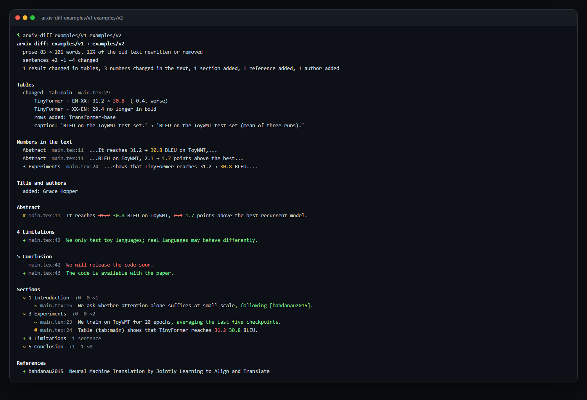

<div align="center">

# arxiv-diff

**What changed between two versions of a paper, and did the results change?** arxiv-diff reads both versions'
LaTeX and tells you, first, which numbers in the result tables changed (by row and column: "Transformer (big) ·
BLEU EN-FR: 41.0 → 41.8"), then the numbers that changed in the text, the abstract and conclusion, every section's
added, removed and rewritten sentences, the figures, the authors and the references. Any two arXiv versions, or two
LaTeX folders, or two commits of your own paper.

<a href="https://github.com/zch6a/arxiv-diff/actions/workflows/ci.yml"></a>

<a href="LICENSE"></a>

**English** · [简体中文](README.zh-CN.md)

</div>

---

arXiv keeps every version of a paper, but shows you only the PDFs. A reviewer checking a revision, a reader citing a
number, a group reproducing a result: each wants to know whether the numbers they rely on are still the ones in the
paper. A text diff of the LaTeX drowns them in reflowed lines and moved paragraphs; latexdiff marks up a PDF you then
have to read end to end. arxiv-diff compares what the paper says, and puts the results first.

Its real output on *Attention Is All You Need*, v1 (June 2017) against v7 (August 2023), shortened:

```text
$ arxiv-diff 1706.03762
arxiv-diff: v1 → v7  1706.03762 "Attention Is All You Need" (2017-06-12 → 2023-08-02)
  prose 3,711 → 3,831 words, 4% of the old text rewritten or removed
  sentences +9 -8 ~17 changed
  2 results changed in tables, 1 number changed in the text, 2 table rows added, 1 figure changed, 4 references added

Tables
  changed  tab:wmt-results  results.tex:8
      Transformer (big) · BLEU EN-FR: 41.0 → 41.8  (+0.8, better)
  changed  tab:variations  results.tex:54
      base · $d_{\text{ff}}$: 1024 → 2048  (+1024)
      params $\times10^6$: 8 cells emptied (was 65): (A); (A) (2); (A) (3); (A) (4); (D); (D) (2); ... (8)
      rows added: (E) | positional embedding instead of sinusoids

Numbers in the text
  Abstract  ms.tex:127  ...art BLEU score of 41.0 → 41.8 after training for 3.5...

Abstract
  # ms.tex:127  On the WMT 2014 English-to-French translation task, our model establishes a new single-model
                state-of-the-art BLEU score of [-41.0-] {+41.8+} after training for 3.5 days on eight GPUs, ...
...
References
  + he2016deep  Deep residual learning for image recognition
  + sukhbaatar2015  End-to-end memory networks
```

Each of those changes is real (checked by hand in the two sources): the EN-FR result was corrected to 41.8, the base
model's feed-forward size in Table 3 from 1024 to 2048.

The same on [the example](examples/) (a made-up paper in two versions), in colour:

<p align="center"></p>

## Install

```bash
uv tool install git+https://github.com/zch6a/arxiv-diff     # or: pipx install git+https://github.com/zch6a/arxiv-diff
```

Or run it once without installing: `uvx --from git+https://github.com/zch6a/arxiv-diff arxiv-diff 1706.03762`.

## Use

```bash
arxiv-diff 2106.09685                     # v1 against the latest version
arxiv-diff 2106.09685v2                   # v1 against v2
arxiv-diff 1706.03762v3 1706.03762v7      # any two versions
arxiv-diff 1706.03762 --all               # every version against the next
arxiv-diff paper-v1/ paper-v2/            # two LaTeX folders (or two main .tex files)
```

| option | |
|---|---|
| `--format html -o diff.html` | one self-contained page: the two versions side by side, tables first, filters for "only sentences whose numbers changed" |
| `--format markdown` | for a pull request comment or a job summary (nothing from the paper renders as a link, image or HTML) |
| `--format json` | everything: each sentence with its file and line in its version, each table cell with its line in the new version |
| `--full` | every changed sentence (the terminal shows a few per section, Markdown 30), and the sentences of added and removed sections |
| `--fail-on results` / `any` | exit with 1 when a result changed (a number in a table, or replaced by text; a number in a sentence) / when anything changed |
| `--keep DIR` | keep the arXiv sources it fetched, as unpacked (the `.tex`, `.bib`, `.bbl`, `.sty`, `.cls`, `.bst` files; otherwise deleted) |

It exits with 0 when the comparison is done, 1 when `--fail-on` says so, and 2 when it could not compare (a version
arXiv does not have, a PDF-only version, a folder without a LaTeX document).

## What it compares

| | |
|---|---|
| **Tables** | paired by `\label`, then caption, then rows and columns; cells by row name and column header, so a row that moved is still the same row. A changed number (with the difference, and "better"/"worse" when the column's metric or ↑/↓ says which way is better), a changed or cleared cell, the bold "best" marker moving, rows and columns added or removed, the caption |
| **Numbers in the text** | each number that changed in a sentence, with the words around it; `#` marks a sentence where only numbers changed |
| **Sections** | paired by title, then by text: a renamed section is still the same section, a moved one is marked moved; sentences paired within, each changed one as a word diff; a sentence that moved to another section is "moved", not removed and added |
| **Abstract, conclusion** | listed on their own |
| **Front matter** | title; authors added, removed or reordered (affiliations, e-mails and footnotes left out) |
| **Figures** | added, removed; the image files they show; the caption |
| **References** | cited references added and removed (a key renamed is not a change), and an entry that went from preprint to published version |

The LaTeX is read the way [paper-proof](https://github.com/zch6a/paper-proof) reads it: `\input` and `\include`
followed, comments and `\iffalse` blocks dropped. The document's own argument-less macros are expanded
(`\newcommand{\method}{FooNet}`), so the text reads as the paper prints it; citations show as `[keys]`, references as
`‹labels›`, math as written.

## In a pull request

For a paper written in a git repository: what changed in the paper in this pull request, as a job summary.

```yaml
on: pull_request
permissions:
  contents: read
jobs:
  paper:
    runs-on: ubuntu-latest
    steps:
      - uses: actions/checkout@v4
        with:
          fetch-depth: 0
      - uses: zch6a/arxiv-diff@v0
        with:
          path: paper            # the LaTeX folder
          fail-on: never         # or "results": fail when a number changed
```

The old version is the pull request's base commit (`base:` to choose another ref, or `old:` for a folder). The
outputs `report` (JSON) and `markdown` are files you can post as a comment in a later step.

## How well it works

Measured on 20 well-known papers that have several arXiv versions (v1 against the latest; BERT, ALBERT, ViT, Swin,
LoRA, Longformer, GPT-3, DDPM, Latent Diffusion, Chain-of-Thought, FlashAttention and others), with
[`scripts/measure_versions.py`](scripts/measure_versions.py):

| | |
|---|---|
| **Tables, audited** | 389 pairs of tables. The audit is independent of the report: every number that left a table or arrived in it must be explained by a reported change (a changed or cleared cell, a row or column added or removed). Unexplained: **0** |
| **Table results changed** | 131 reported; **69 checked by hand** in the two sources, all real (ViT's corrected exaFLOPs, ALBERT's re-run results, LoRA's new baselines, Latent Diffusion's new text-to-image model, BERT's QNLI 91.1 → 92.7, ...) |
| **Numbers changed in the text** | 30, each read in its sentence: all real edits (BERT's abstract, ALBERT's gains, Swin's 86.4 → 87.3 and 60 → 90 epochs, ...) |
| **Authors** | right in all 40 versions; the 3 changes reported (RoFormer, LoRA, Chain-of-Thought gained authors) are real |

Then on 35 more: the other 16 of those papers with several versions (BLIP-2, LLaVA, Flan, DPO, MT-Bench, …; 200 table
pairs audited, 0 unexplained) and 19 outside machine learning (theoretical physics, PDEs, condensed matter, astronomy,
neuroscience, quantum physics, combinatorics, econometrics, fluid dynamics, statistics; 69 table pairs, 0
unexplained). Outside machine learning most numbers that change are in formulas: those are shown in the sentences'
word diffs but not listed as changed numbers, which brought the list from 47 to 16 entries, all real edits.

Measuring found what tests had not, and each case is now a test: a row and its starred twin read as one row
(Swin), a change in the second number of a cell like `89.3/82.1` missed (ALBERT), rows and columns whose names
changed a little left unpaired (ALBERT's `59M` → `60M`, LoRA's `Accuracy` → `Acc.`), and, between two rows named
alike, the wrong one paired (LoRA's two Adapter rows: now the one with the old row's results), cells written with
the paper's own command (`\cell{6.5}{0.4}`), years inside citation keys taken for changed numbers, and author lists
wrapped over two lines.

## Limits

- It compares the LaTeX. A number that changed only inside a figure's image, or a version submitted as a PDF only,
  is not seen. The paper's own commands are expanded, except those with an optional argument and `\def` with parameters,
  which are compared as written.
- Tables are read by paper-proof's parser (`tabular`, `tabularx`, `longtable`, `\multicolumn`, `\multirow`,
  booktabs); a table drawn some other way is compared as text, or not at all.
- A sentence rewritten beyond recognition shows as one removed and one added.

## Also in this toolkit

[paper-proof](https://github.com/zch6a/paper-proof) checks a paper's references and its numbers against its own
tables; [submit-check](https://github.com/zch6a/submit-check) checks it against a venue's submission rules.

## License

MIT
