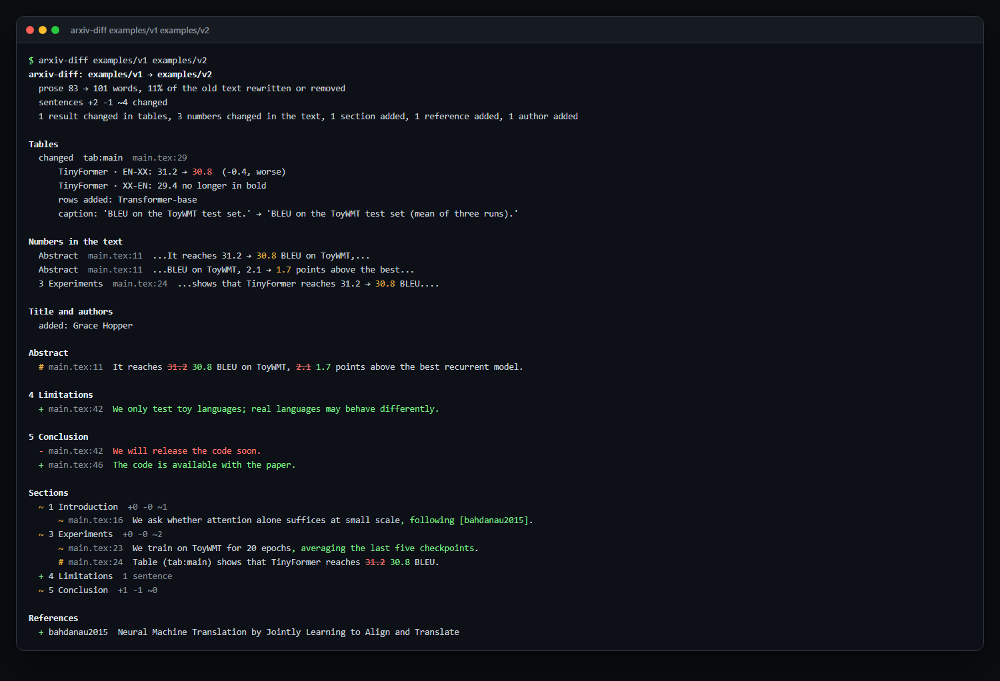

<div align="center">

# arxiv-diff

**一篇论文的两个版本之间改了什么，结果变没变？** arxiv-diff 读两个版本的 LaTeX，先告诉你结果表里哪些数字变了（按行和列：
“Transformer (big) · BLEU EN-FR: 41.0 → 41.8”），再列出正文里变了的数字、摘要和结论的改动、每一节增删改的句子、图、作者和参考文献。
任意两个 arXiv 版本、两个 LaTeX 文件夹，或你自己论文仓库的两个提交都行。

<a href="https://github.com/zch6a/arxiv-diff/actions/workflows/ci.yml"></a>

<a href="LICENSE"></a>

[English](README.md) · **简体中文**

</div>

---

arXiv 保存了论文的每个版本，却只给你看 PDF。不管是核对修改稿的审稿人、引用某个数字的读者，还是想复现结果的团队，都想知道自己依赖的数字是否还是论文里的那个。
对 LaTeX 做文本 diff，会被重新折行和挪动的段落淹没；latexdiff 生成一份标注过的 PDF，你还得从头读到尾。arxiv-diff 比较的是论文说了什么，并把结果放在最前面。

它在 *Attention Is All You Need* 上的真实输出（v1，2017 年 6 月，对比 v7，2023 年 8 月；有删节）：

```text
$ arxiv-diff 1706.03762
arxiv-diff: v1 → v7  1706.03762 "Attention Is All You Need" (2017-06-12 → 2023-08-02)
  prose 3,711 → 3,831 words, 4% of the old text rewritten or removed
  sentences +9 -8 ~17 changed
  2 results changed in tables, 1 number changed in the text, 2 table rows added, 1 figure changed, 4 references added

Tables
  changed  tab:wmt-results  results.tex:8
      Transformer (big) · BLEU EN-FR: 41.0 → 41.8  (+0.8, better)
  changed  tab:variations  results.tex:54
      base · $d_{\text{ff}}$: 1024 → 2048  (+1024)
      params $\times10^6$: 8 cells emptied (was 65): (A); (A) (2); (A) (3); (A) (4); (D); (D) (2); ... (8)
      rows added: (E) | positional embedding instead of sinusoids

Numbers in the text
  Abstract  ms.tex:127  ...art BLEU score of 41.0 → 41.8 after training for 3.5...

Abstract
  # ms.tex:127  On the WMT 2014 English-to-French translation task, our model establishes a new single-model
                state-of-the-art BLEU score of [-41.0-] {+41.8+} after training for 3.5 days on eight GPUs, ...
...
References
  + he2016deep  Deep residual learning for image recognition
  + sukhbaatar2015  End-to-end memory networks
```

上面每一处改动都在两个版本的源码里人工核对过：EN-FR 结果改成了 41.8，表 3 里 base 模型的前馈维度从 1024 改成了 2048。

在[示例](examples/)（一篇虚构论文的两个版本）上的彩色输出：

<p align="center"></p>

## 安装

```bash
uv tool install git+https://github.com/zch6a/arxiv-diff     # 或：pipx install git+https://github.com/zch6a/arxiv-diff
```

不安装、只跑一次：`uvx --from git+https://github.com/zch6a/arxiv-diff arxiv-diff 1706.03762`。

## 用法

```bash
arxiv-diff 2106.09685                     # v1 对比最新版本
arxiv-diff 2106.09685v2                   # v1 对比 v2
arxiv-diff 1706.03762v3 1706.03762v7      # 任意两个版本
arxiv-diff 1706.03762 --all               # 每个版本对比下一个
arxiv-diff paper-v1/ paper-v2/            # 两个 LaTeX 文件夹（或两个主 .tex 文件）
```

| 选项 | |
|---|---|
| `--format html -o diff.html` | 一个自包含的网页：两个版本并排，表格在前，可筛选“只看数字变了的句子” |
| `--format markdown` | 用于 PR 评论或 job summary（论文里的内容不会渲染成链接、图片或 HTML） |
| `--format json` | 全部内容：每个句子带它所在版本的文件和行号，每个表格单元格带它在新版本里的行号 |
| `--full` | 显示每一个改动的句子（终端默认每节几条、Markdown 30 条），以及新增和删除章节里的句子 |
| `--fail-on results` / `any` | 结果变了（表格里的数字变了或被文字取代；句子里的数字变了）/ 任何内容变了时退出码为 1 |
| `--keep DIR` | 保留从 arXiv 取来并解压的源码（`.tex`、`.bib`、`.bbl`、`.sty`、`.cls`、`.bst`；默认用完即删） |

退出码：比较完成为 0；`--fail-on` 条件满足为 1；无法比较为 2（arXiv 上没有该版本、某版本只有 PDF、文件夹里没有 LaTeX 文档）。用 `--all` 时，能比较的步骤照常报告，其余的会列出；此时退出码为 2（`--fail-on` 条件满足时为 1）。

## 比较什么

| | |
|---|---|
| **表格** | 先按 `\label`，再按标题，再按行列配对；单元格按行名和列名对齐，行挪了位置也还是同一行。报告变了的数字（带差值；列的指标或 ↑/↓ 说明方向时标“更好/更差”）、改动或清空的单元格、加粗“最佳”标记的移动、增删的行和列、表格标题 |
| **正文里的数字** | 句子中每个变了的数字及其上下文（不含公式里、引用 key、交叉引用标签和 DOI 里的数字；公式的改动显示在句子的词级 diff 里）；`#` 标出只有数字变了的句子 |
| **章节** | 先按标题、再按内容配对：改名的节还是同一节，挪动的节标为 moved；节内按句子配对，改动的句子给出词级 diff；挪到别的节的句子标为“移动”，不算删除加新增 |
| **摘要、结论** | 单独列出 |
| **前置信息** | 标题；作者的增删和顺序变化（不含单位、邮箱和脚注） |
| **图** | 增删、所显示的图片文件、图注 |
| **参考文献** | 引用的文献增删（只改 key 不算），以及从预印本变成正式发表版本的条目 |

LaTeX 的读取方式与 [paper-proof](https://github.com/zch6a/paper-proof) 相同：跟随 `\input` 和 `\include`，去掉注释和 `\iffalse` 块。
文档里自定义的命令连同参数会被展开（`\newcommand{\method}{FooNet}`、`\newcommand{\cell}[2]{#1$\pm$#2}`），`\iflatexml` 分支不读，文字读起来就是论文印出来的样子。引用显示为 `[keys]`，交叉引用显示为 `‹labels›`，公式保持原样。

## 在 Pull Request 里用

论文放在 git 仓库里写时：把这次 PR 对论文的改动写进 job summary。

```yaml
on: pull_request
permissions:
  contents: read
jobs:
  paper:
    runs-on: ubuntu-latest
    steps:
      - uses: actions/checkout@v4
        with:
          fetch-depth: 0
      - uses: zch6a/arxiv-diff@v0
        with:
          path: paper            # LaTeX 文件夹
          fail-on: never         # 或 "results"：有数字变化就失败
```

旧版本默认是 PR 的 base 提交（用 `base:` 指定其他 ref，或用 `old:` 指定一个文件夹）。输出 `report`（JSON）和 `markdown` 是文件，可以在后续步骤里发成评论。

## 效果如何

在 20 篇有多个 arXiv 版本的知名论文上测量（v1 对比最新版本；BERT、ALBERT、ViT、Swin、LoRA、Longformer、GPT-3、DDPM、Latent Diffusion、Chain-of-Thought、FlashAttention 等），脚本见 [`scripts/measure_versions.py`](scripts/measure_versions.py)：

| | |
|---|---|
| **表格审计** | 389 对表格。审计独立于报告：每个从表格里消失或新出现的数字，都必须由报告中的某处改动解释（单元格改动或清空、行列增删）。无法解释的：**0** |
| **表格结果变化** | 报告 131 处；其中 **69 处在两个版本的源码里人工核对**，全部属实（ViT 更正的 exaFLOPs、ALBERT 重跑的结果、LoRA 新增的基线、Latent Diffusion 新的文生图模型、BERT 的 QNLI 91.1 → 92.7 等） |
| **正文数字变化** | 30 处，逐句阅读：全部是真实改动（BERT 摘要、ALBERT 的提升幅度、Swin 的 86.4 → 87.3 和 60 → 90 epochs 等） |
| **作者** | 40 个版本全部读对；报告的 3 处变化（RoFormer、LoRA、Chain-of-Thought 新增作者）属实 |

之后又测了 35 篇：上述论文清单里其余 16 篇多版本论文（BLIP-2、LLaVA、Flan、DPO、MT-Bench 等；审计 200 对表格，无法解释的 0 个），以及 19 篇机器学习以外的论文（理论物理、偏微分方程、凝聚态、天文、神经科学、量子物理、组合数学、计量经济、流体力学、统计；69 对表格，无法解释的 0 个）。机器学习以外的论文里，变化的数字大多在公式里：它们出现在句子的词级 diff 中，但不列为“数字变化”，列表因此从 47 条降到 16 条，全部是真实改动。

测量发现了测试没覆盖的问题，每一个现在都有测试：一行和它带星号的同名行被当成一行（Swin）；`89.3/82.1` 这类单元格里第二个数的变化被漏掉（ALBERT）；名字稍有变化的行和列没配上（ALBERT 的 `59M` → `60M`、LoRA 的 `Accuracy` → `Acc.`）；两行名字相近时配错了行（LoRA 的两个 Adapter 行，现在按结果数字选对那一行）；用论文自定义命令写的单元格（`\cell{6.5}{0.4}`）；引用 key 里的年份被当成数字变化；跨两行的作者列表。

## 局限

- 比较的是 LaTeX。只在图片里变了的数字，或只提交了 PDF 的版本，看不到。论文自定义的命令会展开，但带可选参数的命令和带参数的 `\def` 按原文比较。
- 表格由 paper-proof 的解析器读取（`tabular`、`tabularx`、`longtable`、`\multicolumn`、`\multirow`、booktabs）；用别的方式画的表格按文字比较，或比较不到。
- 改得面目全非的句子显示为一删一增。

## 同一套工具

[paper-proof](https://github.com/zch6a/paper-proof) 检查论文的参考文献，以及正文数字与自身表格是否一致；[submit-check](https://github.com/zch6a/submit-check) 按会议的投稿规则检查论文。

## 属于 research-kit

这是 13 个开源科研工具之一，覆盖从读论文到论文发表之后。全部工具按科研流程的介绍，以及安装它们技能的 Claude Code 插件市场，见 [research-kit](https://github.com/zch6a/research-kit) · [网站](https://zch6a.github.io/research-kit/)。

## 许可证

MIT
